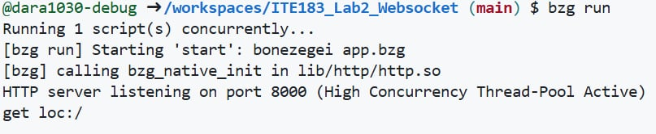
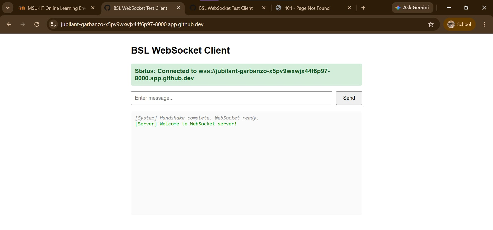
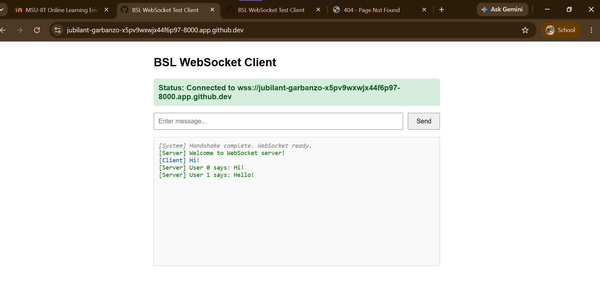
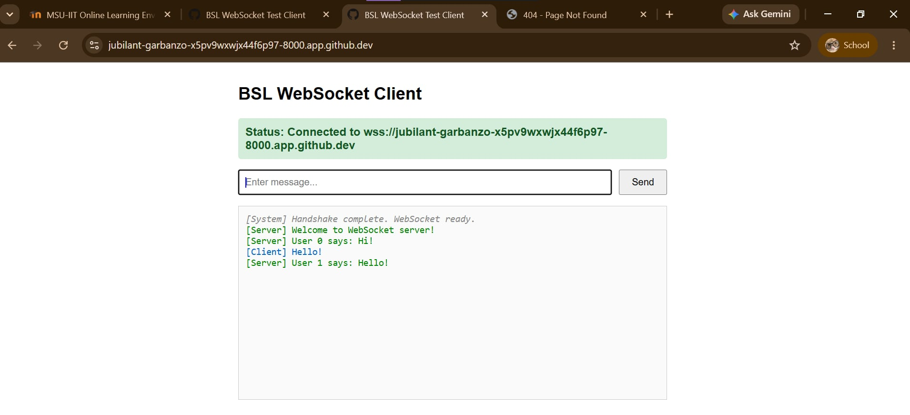
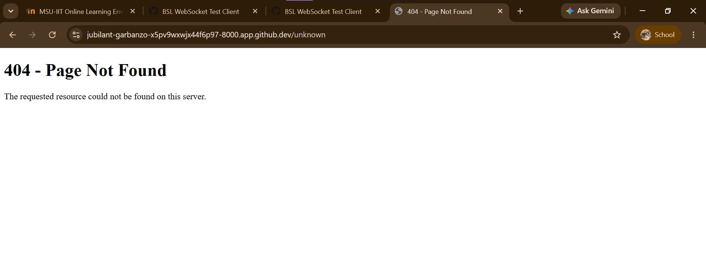

# BSL WebSocket Server

A WebSocket chat server built using the Bonezegei Scripting Language (BSL) and the BSL HTTP Library.

This project demonstrates how a WebSocket server can handle browser connections, send welcome messages, receive client messages, broadcast messages to multiple connected clients, and serve web pages through HTTP requests.

## Project Description

The BSL WebSocket Server is a simple web-based chat application developed for **Laboratory Activity 2: WebSocket Server**.

The server uses the BSL HTTP Library to handle HTTP requests and WebSocket communication. It runs on port `8000` and provides the following functionality:

- `/` — displays the WebSocket chat client.
- WebSocket connection — establishes a connection between the browser and the server.
- Welcome message — sends a welcome message when a client connects.
- Message broadcasting — sends a message from one client to all connected clients.
- Client disconnection — detects when a client disconnects.
- Any unsupported route — displays a custom 404 Not Found page.

The main purpose of this project is to demonstrate WebSocket communication using BSL. Unlike ordinary HTTP requests, WebSockets allow a persistent connection between the client and server, making real-time communication possible without repeatedly sending new HTTP requests.

## Technologies Used

- Bonezegei Scripting Language (BSL)
- BSL HTTP Library
- Visual Studio Code
- Git and GitHub
- HTML
- JavaScript
- HTTP
- WebSocket
- GitHub Codespaces

## Project Structure

```text
ITE183_Lab2_Websocket/
|-- .gitattributes
|-- LICENSE
|-- README.md
|-- app.bzg
|-- package.json
|-- documentation/
|   |-- broadcast_client1.png
|   |-- broadcast_client2.png
|   |-- client_connected.png
|   |-- custom_404.png
|   `-- server_running.png
|-- lib/
|   |-- http.bzg
|   |-- http.json
|   `-- http/
|       `-- http.so
`-- public/
    |-- index.html
    `-- 404.html
```

*Note: The actual library files may vary depending on the operating system and the files generated or installed by the package manager.*

## Installation and Setup

### 1. Install Visual Studio Code

Install Visual Studio Code and use it as the development environment for the project.

Open the Extensions tab using:

```text
Ctrl + Shift + X
```

Search for Bonezegei and install the Bonezegei Scripting Language Formatter extension.

### 2. Install the Bonezegei Interpreter

Install the Bonezegei Scripting Language interpreter. This project was run using Bonezegei version `1.3.3` in GitHub Codespaces.

Verify the installation by running:

```bash
bonezegei -v
```

The terminal should display the installed Bonezegei version.

### 3. Open the Project

Open the `ITE183_Lab2_Websocket` repository in Visual Studio Code or GitHub Codespaces.

Make sure the project contains these files:

```text
app.bzg
lib/http.bzg
public/index.html
public/404.html
package.json
```

### 4. Install the Required Library

Open a terminal in the project root directory and run:

```bash
bzg install
```

This installs the required library or dependencies specified by the project.

### 5. Run the WebSocket Server

From the project root directory, run:

```bash
bzg run
```

If everything is configured correctly, the terminal should display a message similar to:

```text
[bzg] calling bzg_native_init in lib/http/http.so
HTTP server listening on port 8000 (High Concurrency Thread-Pool Active)
```

This indicates that the server has started and is listening on port `8000`.

When using GitHub Codespaces, open the **Ports** tab and access port `8000` through its forwarded browser URL.

## Usage Instructions

Once the server is running, open the forwarded port `8000` URL in a web browser. The chat client should connect to the server using a secure WebSocket connection (`wss://`) when accessed through the HTTPS Codespaces URL.

### 1. Server Running

The terminal displays the server startup message and confirms that the WebSocket server is listening on port `8000`.



### 2. Client Connected

Open the chat client in the browser. When the connection is successful, the client displays its connection status and receives a welcome message from the server.



### 3. Broadcasting a Message from Client 1

Open the chat client in the first browser window and send a message. The server receives the message and broadcasts it to all connected clients.



### 4. Receiving the Broadcast on Client 2

Open the chat client in another browser window or tab using the same forwarded URL. When Client 1 sends a message, Client 2 should also receive the broadcast message.

This demonstrates real-time communication between multiple clients through the WebSocket server.



### 5. Testing the Custom 404 Page

To test the custom 404 page, open an unsupported route by adding `/test` to the forwarded port URL.

For example:

```text
https://YOUR-CODESPACE-8000.app.github.dev/test
```

Replace the example domain with your actual Codespaces URL.

The server should display the custom 404 Not Found page because the requested route is not mapped to the home page.



Other unsupported routes can also be tested. The server should return the same custom 404 page for routes other than `/`.

## Server Implementation

The server is implemented in `app.bzg` and uses the BSL HTTP Library.

The server performs the following operations:

1. Initializes the server on port `8000`.
2. Handles incoming HTTP requests and serves `public/index.html` for the `/` route.
3. Serves `public/404.html` for unsupported routes.
4. Detects new WebSocket connections and sends a welcome message to the connecting client.
5. Receives messages from clients and broadcasts them to all connected clients.
6. Detects client disconnections and logs the event in the terminal.

The browser interface is implemented in `public/index.html` using HTML and JavaScript. It connects to the server through WebSockets and displays incoming and outgoing chat messages.

## Troubleshooting

If the chat client cannot connect to the server, check the following:

- Make sure the server is still running in the terminal.
- Run `bzg install` before starting the server if the required library has not been installed.
- Run `bzg run` from the project root directory.
- Make sure port `8000` is forwarded and accessible in GitHub Codespaces.
- Use `wss://` when connecting through an HTTPS Codespaces URL. The client should use `ws://` for ordinary HTTP access and `wss://` for HTTPS access.
- Confirm that `public/index.html` uses the correct forwarded host rather than a hardcoded `localhost` address.
- Check the terminal for errors related to loading the HTTP library or starting the server.

## License

This project is licensed under the MIT License. See the `LICENSE` file for details.